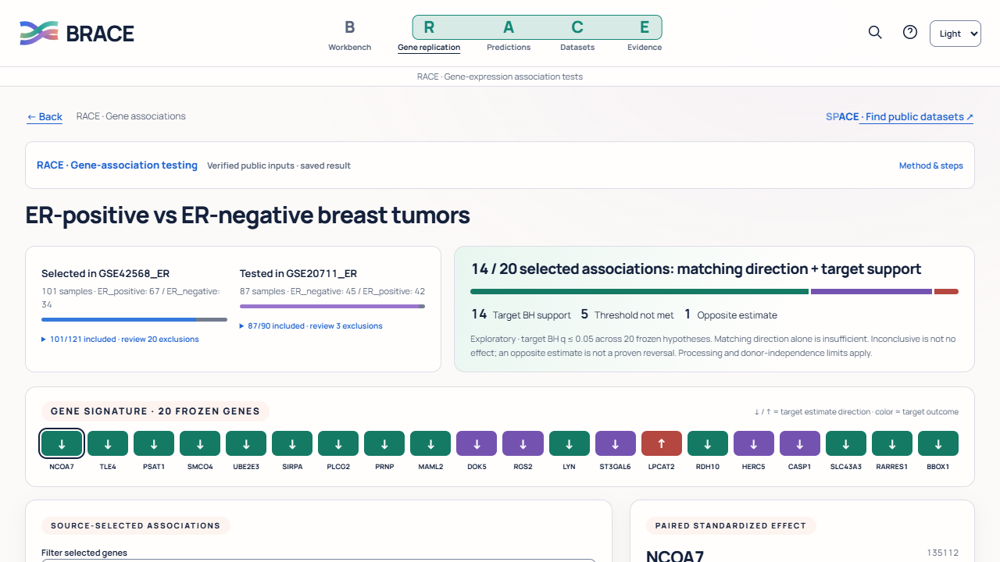

# BRACE

**Biological Reliability Assessment across Cohorts and Experiments**

A local research workbench for testing whether gene-expression associations carry across studies, evaluating saved classification predictions, and sharing the calculation record.



## Get BRACE

[Downloads and release notes](https://github.com/hasan-bukhari-dev/BRACE/releases) · [First useful task](docs/v6/USER_TASKS.md) · [Methods and limits](docs/SCIENTIFIC_PROTOCOL_1_0.md) · [Actual before/after screens](docs/v6/SCREEN_REVIEW.html)

**V6 is a research preview.** Windows is the first locally tested bundled-app target. Other platform builds are tested separately; do not infer macOS/Linux GUI acceptance from Windows results. See each release's verification receipt for what actually ran. The application is not clinically validated.

For a Windows portable download, extract the whole folder and open `BRACE.exe`. An installer, when attached to the release, provides Start-menu access and uninstall. Bundled downloads include Python and dependencies; no separate Python installation is required. Keep the small BRACE controller open while working; **Stop & close** shuts down the local server safely.

## What can I do?

| Tool | Research task |
|---|---|
| **B · Workbench** | Choose files, reopen studies and distinguish saved evidence from a fresh computation |
| **RACE** | Select gene associations in a supported source study, freeze them, then test the same contrast in the target |
| **ACE** | Score saved predictions against known labels, or fit the supported source-only normal/tumor baseline |
| **FACE** | Inspect the actual measurements or prediction record behind a result |
| **C · Dataset checks** | Check task-specific inputs and describe distribution differences using source-fitted PCA and feature statistics |
| **TRACE** | Inspect recorded methods, settings, selected results and exact artifacts |
| **EMBRACE** | Export readable HTML and machine-readable evidence with hashes and reproduction guidance |
| **SPACE** | Search official GEO metadata, shortlist candidates, verify matrix filenames and acquire bounded original public files |

SPACE finds candidates; it does not automatically curate labels, normalize data or authenticate independent patients. Current RACE supports declared normalized log2 human microarrays, not raw FASTQ/CEL processing or general RNA-seq differential expression. Imported prediction evaluation does not execute the user's classifier.

## Start with real data

**Open saved public result** opens the included exploratory GSE42568 → GSE20711 ER-association evidence. **Run the public example again** loads its exact verified inputs for review, checks and a fresh computation. The original files, deterministic preparation and citations are included.

The prepared pair contains **101 / 87 tumors**, 10,000 source-filtered features and 20 source-frozen associations. Fourteen have matching direction and target statistical support; five match without support; one has an opposite estimate. These numbers describe this example, not a promised outcome on new data. Differences in processing, ER assays and unauthenticated donor independence remain explicit limitations. [Data sources and reuse considerations](DATA_SOURCES.md).

Historical CancerShift examples are saved prediction evidence. Artificial examples test software behavior and remain labeled as such.

## Run from source

Use standard **64-bit CPython 3.11–3.13**. The local Windows acceptance environment used 3.11.9. Install dependencies in the project `.venv`.

**Windows:** run `SETUP_BRACE_WINDOWS.bat`, then `START_BRACE_WINDOWS.bat`.

**macOS/Linux:** run `sh SETUP_BRACE.sh`, then `sh START_BRACE.sh`. These scripts use a local virtual environment and leave global packages alone.

Alternatively:

```sh
python -m venv .venv
# Activate .venv using your platform's command, then:
python -m pip install -r requirements-release.txt
python launch.py
```

Open the exact loopback address printed by the launcher. Port 8765 is the default; a safe unused-port fallback leaves other services running. Source startup remains the same Python/FastAPI application; no frontend substitution is used.

## Privacy, storage and offline operation

The server binds only to `127.0.0.1`. Bundled examples, fonts, charts and computations work offline after installation. Only explicitly submitted SPACE public search fields go to NCBI; uploads are not part of discovery requests.

Bundled desktop data folders:

- Windows: `%LOCALAPPDATA%\BRACE`
- macOS: `~/Library/Application Support/BRACE`
- Linux: `${XDG_DATA_HOME:-~/.local/share}/BRACE`

Runs and logs are outside installed resources, survive application upgrades, and are retained on uninstall. Source `launch.py` keeps its existing project-local `runs/` default. `BRACE_DATA_DIR` changes the native launcher's data folder; `BRACE_RUNS_DIR` explicitly selects run storage. No telemetry, account, cloud backend or LLM is needed.

## Verification and release

```sh
python verify_release.py
python -m pytest -q
python scripts/release_smoke.py
```

V6's original refinement passed 309 tests and the documented browser/numerical checks. Packaging adds focused tests and checks the actual bundled executable; current results belong in the release verification receipt. [V6 engineering report](PRODUCT_REFINEMENT_V6_REPORT.md) · [Build/release guide](docs/release/RELEASING.md) · [Human/device checks still pending](docs/v6/HUMAN_ACCEPTANCE_PENDING.md).

## Rights and contributions

**Rights reserved; this is not an open-source licence.** See [LICENSE](LICENSE), [third-party notices](THIRD_PARTY_NOTICES.md), [data attribution](DATA_SOURCES.md) and the preserved [contribution/disclosure register](competition/DISCLOSURE_REGISTER.md). Public hosting does not relicense included research data or original CancerShift work. AI assistance in development is disclosed; BRACE has no AI-service runtime.

Please report reproducible bugs without posting private patient data, uploads, access tokens or unreviewed evidence bundles. [Contribution guidance](CONTRIBUTING.md) · [Security reporting](SECURITY.md).
