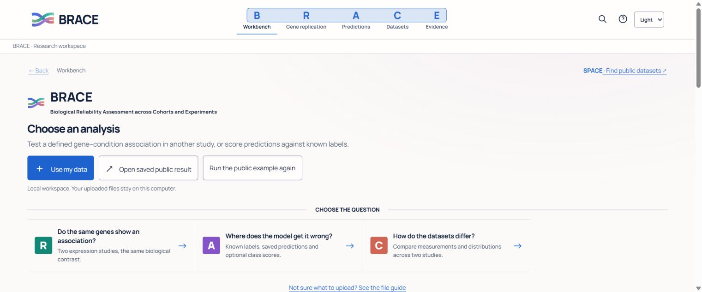

# BRACE

**Biological Reliability Assessment across Cohorts and Experiments**

A local research workbench for cross-cohort gene associations, saved-prediction evaluation and reproducible evidence.

This isolated research working copy is based on `main` at `1d31e71`. Open **OPEN_RESEARCH_FINAL.bat**. See [the consolidated reconstruction and verification record](docs/RESEARCH_FINAL.md) for the changes, measured results, local evidence and remaining limits. Existing release links below describe the upstream baseline, not a newly published release.

[Published V6 Windows release](https://github.com/hasan-bukhari-dev/BRACE/releases/tag/v1.0.0-v6) · [User guide](docs/USER_GUIDE.md) · [Input formats](docs/DATA_GUIDE.md)



## Start

Windows: download the installer, or extract the entire portable ZIP and open `BRACE.exe`. Python is bundled. Keep the controller open while working; **Stop & close** stops its local server.

From source, use standard 64-bit Python 3.11–3.13:

- Windows: `SETUP_BRACE_WINDOWS.bat`, then `START_BRACE_WINDOWS.bat`.
- macOS/Linux: `sh SETUP_BRACE.sh`, then `sh START_BRACE.sh`.

In Workbench, choose **Add reviewed public ER datasets**, review their biological contrast and processing caveats, check eligibility, then compute from the registered versions. SPACE acquisitions are registered automatically; supported general matrices have an explicit preparation editor. You can also open the saved public result or use guided private-file inputs.

[Persistent dataset workflow](docs/DATASET_WORKFLOW.md) · [Architecture](docs/ARCHITECTURE.md) · [Integration status and acceptance](docs/IMPLEMENTATION_REPORT.md)

## Tools

| Tool | Purpose |
|---|---|
| RACE | Select source gene associations, freeze them, then test the same contrast in another study |
| ACE | Evaluate saved predictions or fit the supported source-only baseline |
| FACE / TRACE | Inspect measurements and the recorded calculation |
| Dataset checks | Check task eligibility and describe distribution differences |
| EMBRACE | Export reports, results, methods and hashes |
| SPACE | Find official GEO candidates and verify files; scientific preparation still requires review |

The included GSE42568 → GSE20711 example has 101 / 87 tumors and 20 source-frozen associations. Fourteen have matching direction and target statistical support. It remains exploratory, with processing, phenotype and independence limitations. [Methods](docs/SCIENTIFIC_PROTOCOL_1_0.md) · [Data sources](docs/DATA_SOURCES.md) · [Limits](docs/LIMITATIONS.md).

## Privacy and checks

Computation runs locally on `127.0.0.1`. Bundled examples work offline after installation. Only explicitly submitted public SPACE fields go to NCBI. Private uploads, runs and credentials are excluded from Git. [Storage and reproduction](docs/REPRODUCIBILITY.md).

```sh
python verify_release.py
python -m pytest -q
python scripts/release_smoke.py
```

This branch is the unsigned **1.1.0-dev integration preview**. Its Windows portable build and source checks are documented in the implementation report. The linked published V6 installer is the earlier release. This version has not undergone installer/uninstall, macOS/Linux or unfamiliar-user acceptance testing. [Build guide](docs/release/RELEASING.md) · [Remaining acceptance](docs/ACCEPTANCE.md).

## Rights

BRACE-authored material is **rights reserved**. [License](LICENSE) · [Third-party notices](docs/THIRD_PARTY_NOTICES.md) · [Attribution](docs/ATTRIBUTION.md) · [Contributing](.github/CONTRIBUTING.md) · [Security](.github/SECURITY.md).
