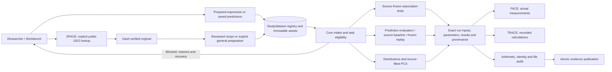

# BRACE architecture

A study contains fixed dataset versions and distinct analysis runs. SPACE discovers/acquires; FACE and TRACE inspect the selected run; EMBRACE publishes its evidence.

| Boundary | Owner | Rule |
|---|---|---|
| Scientific computation | Preserved `brace_core` engines | No browser state or discovery dependencies |
| Assay catalog | `brace_core/assays.py` | Describes validated representations; existing intake remains the conservative eligibility authority |
| Canonical parsing | `intake.py`, `prediction_io.py` | Finite values, exact IDs and explicit declarations |
| General preparation | `preparation.py` | Bounded gzip parsing and reviewed mappings/exclusions |
| Persistence | `dataset_registry.py`, `persistence.py` | Transactional records, immutable assets and atomic records |
| Dataset API | `dataset_api.py` | Versioned requests and server-side handoff to existing task routes |
| Computation services | `server.py`, `study_api.py`, `frozen_workflow.py` | Input snapshots and core delegation; distinct operations |
| Evidence | `molecular_api.py`, `evidence_api.py`, `evidence_audit.py`, `embrace.py` | Exact run linkage and a shared atomic publisher |
| Presentation | ES modules under `static/js/` | Backend eligibility and no cross-run identity fallback |

Copies are staged before records become visible. Concurrent identical registrations converge on one content/transformation identity. Partial uncommitted directories are not listed as successful datasets/runs. Hashes are checked before reuse/export. Saved runs retain provenance snapshots after dataset display-name edits.

For the 1.2.3 maintenance update, scientific engine bytes are compared with release commit `19e2aeb` (1.2.2). Earlier changes from the original research baseline are explicitly recorded in `quality/SCIENTIFIC_CHANGE_REGISTER.json`; the older baseline hash file alone is not a claim that those historical changes never occurred. The new catalog exposes existing capabilities without widening engine acceptance. `style.css`, `v6.css` and `legacy-results.js` still contain active behavior and are retained until equivalent replacements have visual regression coverage.
