# BRACE — Illustrated Researcher's Guide

From Research Data to Verifiable Evidence

Product version: 1.2.4. Scientific scope remains research-only.

## 1. Start with a research question

Select a screenshot in the PDF to open its full-resolution source image. These are authentic application captures; numbered outlines and arrows on the workspace figure are manual annotations.

BRACE runs local research analyses. It does not normalize raw reads, execute uploaded models, establish biological mechanism or provide clinical validation. B opens your workspace; R tests associations; A evaluates classifiers; C compares cohorts; E opens EMBRACE evidence. SPACE acquires public data. FACE and TRACE inspect the active result.

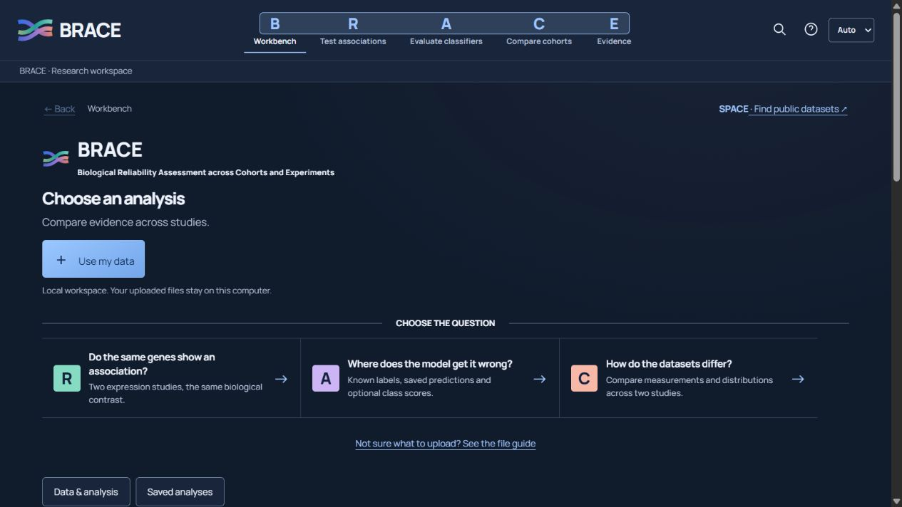

Before starting, install the Windows x64 setup executable from the latest verified GitHub release, or extract the entire portable ZIP and launch BRACE.exe. Keep its controller open. Stop & close ends the server. Source users need standard CPython, the repository setup script and launch script. The installer is unsigned. Windows installer screenshots are not included; lifecycle checks are recorded separately.

## 2. Choose eligible files

Open the question-mark help button. Choose Expression data, Predictions or Other files. Expression matrices have feature_id in the first column and one sample per subsequent column. Metadata has one row per sample, matching sample_id exactly. Predicted classifications require known and predicted classes; optional probabilities must cover every declared class.

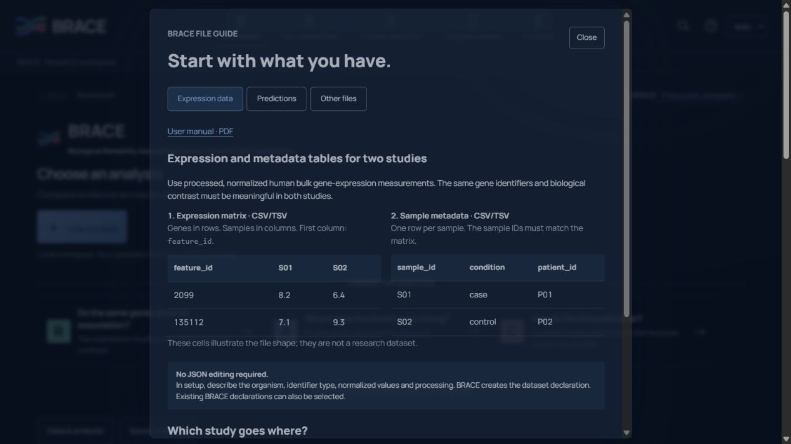

RACE accepts supported unpaired normalized log2 human microarrays. The normal/tumor baseline requires its exact labels. CE accepts its declared normalized representations. Raw counts, FASTQ, CEL and arbitrary model binaries require other preparation or software. A rejected input is not made valid by renaming its extension. See Input formats for exact contracts and budgets.

## 3. Find a public study with SPACE

Choose SPACE · Find public datasets. Enter GSE42568 in Research question or accession. Choose the intended task, then Check files for this GSE accession. The official directory listing identifies actual files; a search result is only a candidate.

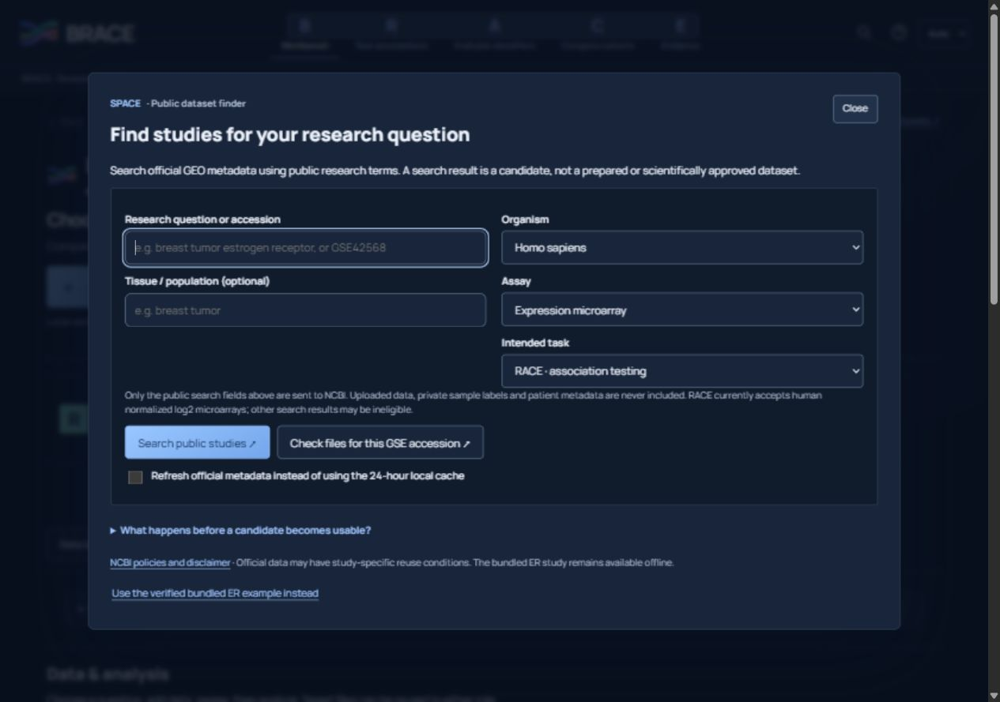

Only the submitted public search fields go to NCBI. Measurements and private sample labels are not included. Internet is needed for uncached discovery. If the remote service fails, retry later or use the bundled reviewed public pair. Do not infer organism, scale or patient independence from the accession alone.

## 4. Acquire the original, then prepare

Choose Acquire original & hash. On success, inspect the original URL and SHA-256 receipt, then Prepare this dataset for analysis. The original is registered and preserved. Download success does not establish eligibility.

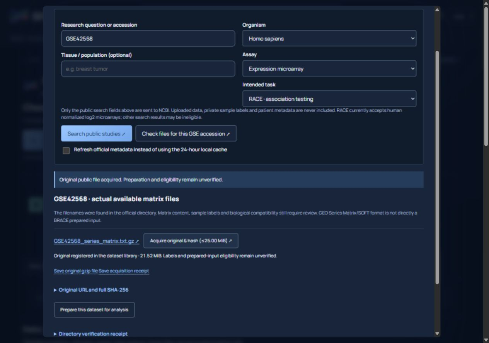

The preparation form reports original samples and features. Review organism, platform, identifier namespace, measurement scale and original processing. BRACE creates processed input files and lineage from reviewed declarations; it does not normalize the original numeric values. An unsupported file needs an externally prepared CSV/TSV input with documented processing.

## 5. Review groups and exclusions

For GSE42568, choose Platform probe IDs, retain GPL570, review the reported GC-RMA processing and select Microarray · normalized log2. Choose er_status under Sample groups. Review the recorded coding: map 1 to ER_positive and 0 to ER_negative. Clear the NA class and give the missing-status exclusion reason.

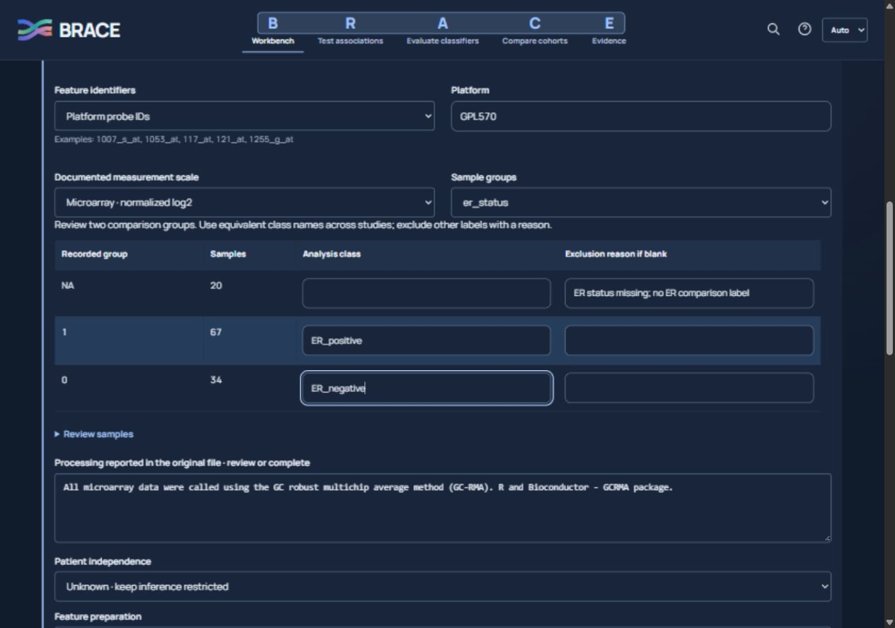

This example retains 101 of 121 samples: 67 positive and 34 negative; 20 have no reviewed ER label. Suggested fields need biological review. Other studies may encode ER differently. Never equate assays just because their class names match. Keep patient independence Unknown unless documented. CE may retain unlabeled samples because it describes measurements, not accuracy.

## 6. Choose a documented feature universe

For a large RACE/CE source, choose Source-only variance and a declared budget. For baseline training, use Fixed identifier panel; source-wide variance selection outside cross-validation is rejected. Review the checkbox and choose Prepare dataset and use in analysis.

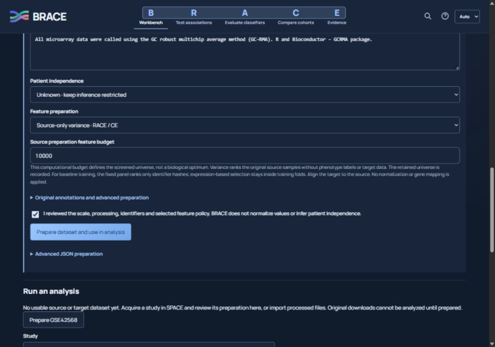

The prepared universe defines what was tested. Variance uses source measurements without target values or labels. The fixed panel ranks identifier hashes without expression values or outcomes; it is a computational subset, not a validated biological panel. Prepare the target with Use prepared source features so matching uses exact source IDs. Missing IDs require a reviewed mapping, not a guessed match.

## 7. Create and check a study

Open Data & analysis. Name the research question and choose the scientific task. Select two prepared versions. A downloaded original remains visible but unavailable until prepared. For a reproducible first calculation, use Add reviewed public ER datasets and review the supplied declarations.

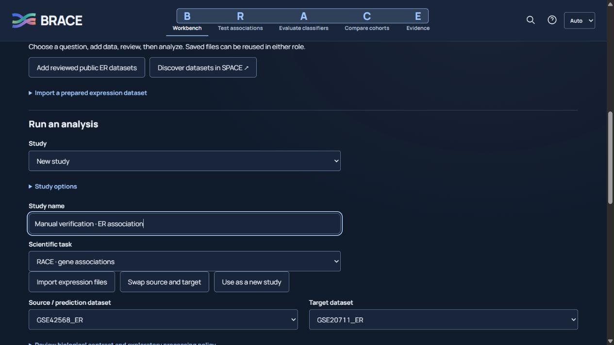

Review the biological contrast and processing policy, then Check selected datasets. Resolve each reason before Compute checked analysis. Source chooses the hypotheses or model; target tests the frozen choice. The same prepared asset can serve either role in a different study. Choosing one asset for both roles is rejected. New acquisitions do not silently become compatible.

## 8. Read RACE without overstating support

Open Open a real-data demonstration, then Open ER association example. This reopens a saved calculation. The historical GSE42568 to GSE20711 configuration has 101 and 87 tumors and 14 of 20 frozen features meeting matching-direction target support. A new calculation is a separate run.

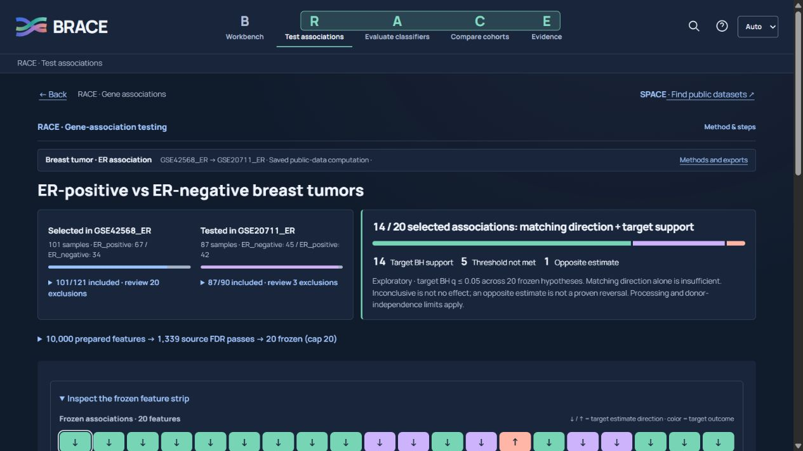

Source BH correction spans the testable prepared universe. Eligible source features are ranked by absolute Hedges g; the declared cap defaults to 20. Target BH correction spans the frozen hypotheses under the documented undefined-test rules. q <= 0.05 plus matching direction defines operational support. Failure to meet a threshold is not proof of no effect; an opposite estimate is not a proven biological reversal. Twenty probes need not mean twenty distinct genes.

## 9. Inspect FACE measurements and functions

Select a frozen feature, or choose FACE · Gene measurements. The inspector shows the actual included measurements for that run, the two group counts, effect estimates and uncertainty. Open Exact values, processing & exclusions to inspect sample cells.

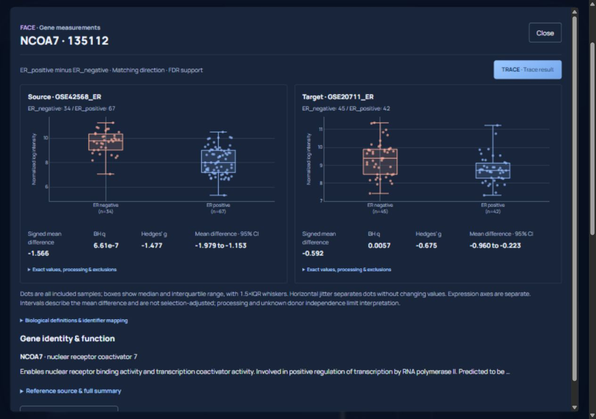

Keep cohort axes separate: differing preprocessing prevents direct interpretation of absolute scale. Gene identity & function shows dated cited reference biology. Look up this gene at NCBI sends only the identifier and namespace. Exact human Entrez IDs, official symbols, reviewed Ensembl cross-references and unambiguous pinned GPL570 probes are supported. Unknown or ambiguous mappings remain unresolved. Cached references work offline and enter subsequent exports; functions do not explain the experiment causally.

## 10. Follow TRACE into EMBRACE

Choose TRACE · Trace result. EMBRACE opens Calculation record for the active run. Follow the recorded inputs, source selection, freeze and target calculation. Readable report gives the research summary; Files & limitations gives exact artifacts and cautions. E and EMBRACE are the same destination.

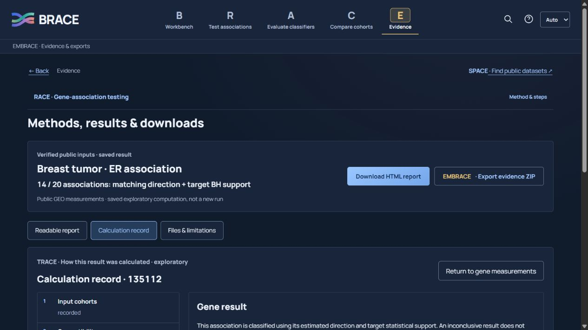

Download HTML report or EMBRACE · Export evidence ZIP. Check the run identity, input hashes and every recorded artifact hash. Ordinary evidence ZIPs omit original uploads, so keep those originals and declarations for reruns. A private workspace backup has different privacy boundaries and includes original files. A calculation record is not biological mechanism or independent validation.

## 11. Evaluate saved predictions in ACE

For an archived example, return to B, expand Open a real-data demonstration and choose Evaluate archived predictions. CancerShift has 680 archived labeled predictions and 668 correct. The original classifier is not executed. For your own table, open Import saved predictions · ACE in Data & analysis.

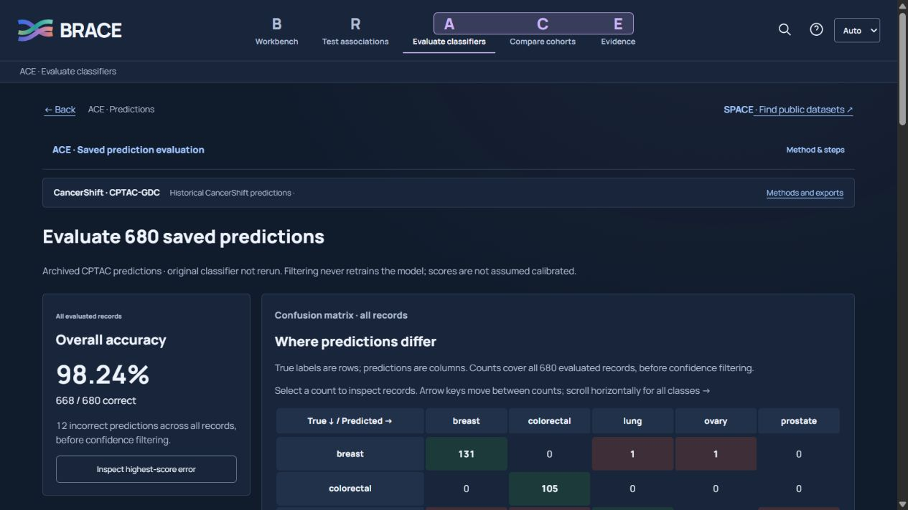

Inspect the selected table columns. Map sample ID, true label and predicted label; declare every model class, including absent classes. Map every probability column or leave all probabilities blank. Supply model identity and the reference-label source, review and save. Choose ACE · saved predictions, check and compute. Class names must match exactly; incomplete or invalid score vectors are rejected.

## 12. Interpret errors, confidence and coverage

Inspect the confusion matrix using its actual/predicted axis labels, class supports and undefined metrics. Select an error to inspect its record. Adjust the confidence cutoff only when scores are available; read the retained count and excluded count alongside the filtered metric.

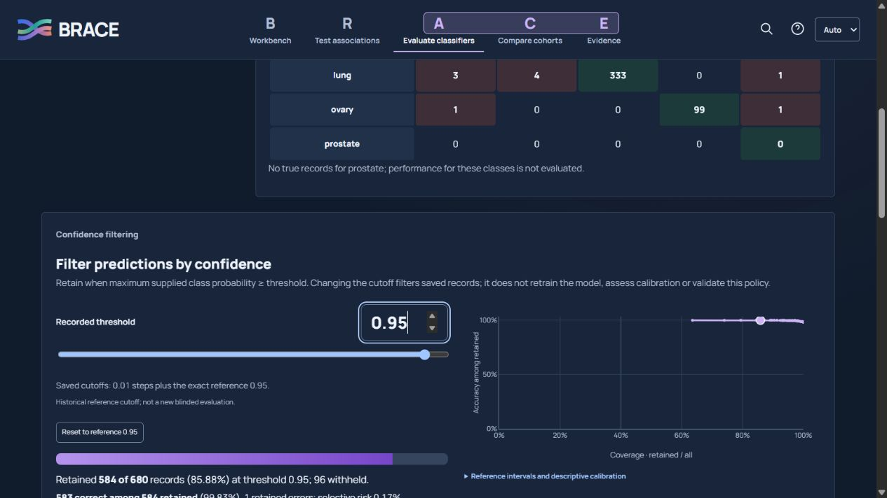

Filtering never edits the original predictions. A high score need not be calibrated probability of correctness. Full-cohort and retained-subset accuracy have different denominators. Missing classes and small supports constrain uncertainty. The archived example has no true prostate cases; that missing class cannot acquire measured sensitivity from predicted labels. Intervals and bootstraps follow the recorded assumptions, not clustered-patient validation.

## 13. Train and replay the supported baseline

Choose ACE · source baseline and eligible source/target expression versions. Use the supported normal/tumor labels, reviewed assay/processing and an outcome-blind fixed preparation panel when a subset is required. Check eligibility, then compute. Source cross-validation and target evaluation are separate.

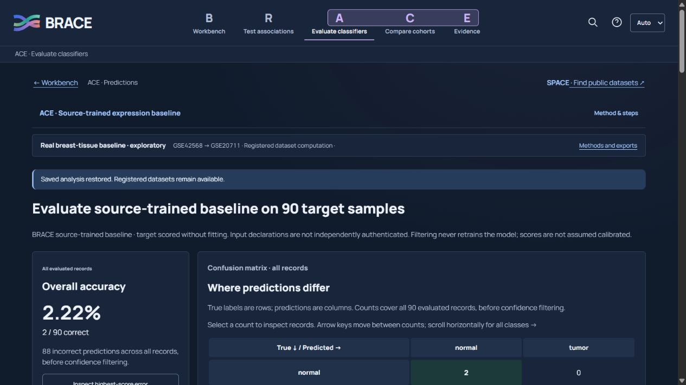

The illustrated real fixed-panel example has 117/121 correct source out-of-fold predictions and 2/90 correct target predictions. The target contains only two normal samples. This records poor transfer in this exploratory configuration; it is not a useful classifier validation or a full-transcriptome estimate. The baseline fits preprocessing and the model using source data only. It is not the archived CancerShift ensemble. Under Apply a previously frozen BRACE baseline, select the saved model and a compatible target, check and apply. No target refitting occurs. An unlabeled target receives predictions without invented accuracy. ER-positive/negative data do not become eligible normal/tumor training data by renaming labels.

## 14. Compare measurements with CE

Choose CE · distribution comparison with two prepared datasets, or Compare these cohorts in CE from a RACE result. Inspect shared-feature coverage, descriptive feature differences and the source-fitted PCA projection. Read processing and dependence declarations.

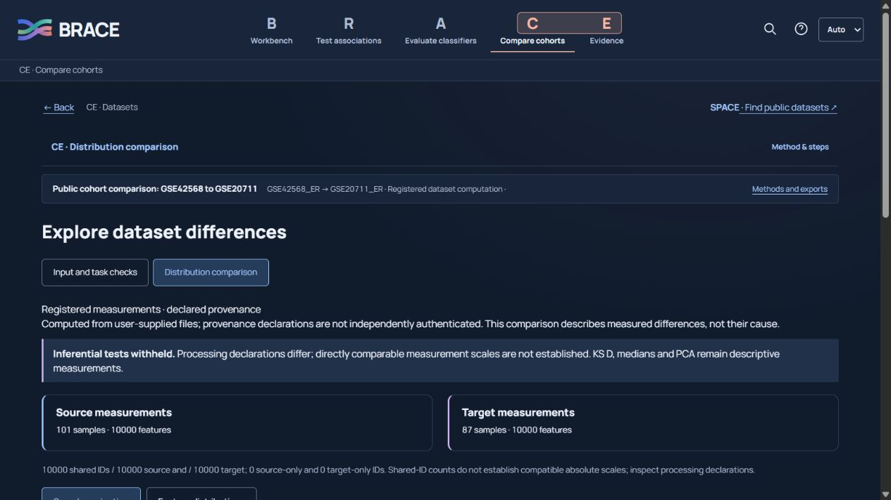

PCA separates variation in the source-fitted measurement space; separation alone does not demonstrate classifier failure. CE withholds inferential p/q values when processing differs or known dependence violates the test. Disabled significance controls explain that restriction. Rank-deficient PCA may be unavailable. Reduced-universe summaries do not represent every original measured feature.

## 15. Reuse, recover and back up

Use Saved analyses to reopen completed runs. Use as a new study preserves an earlier study while changing assignments; Swap source and target changes a new experiment without copying measurement assets. Compare saved analyses shows recorded summaries, not a new pooled hypothesis test. Archive is reversible and does not reclaim disk space.

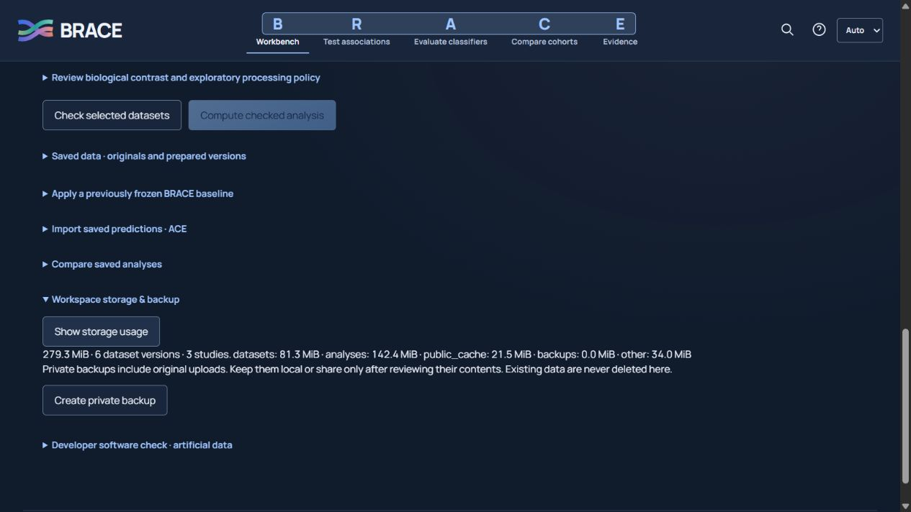

Workspace storage & backup reports usage. Create private backup includes original uploads, prepared versions, the registry, completed runs and cached references with hashes. Keep it private. For an advanced workspace restore, stop BRACE and extract the complete private backup into a separate empty directory. Verify the BACKUP_MANIFEST.json hashes. Set the BRACE_RUNS_DIR launch environment variable to that directory before starting BRACE, then open the restored studies. Keep the original workspace until verification succeeds. There is no in-app workspace-restore button in this release. Browser drafts may need file reselection. Closing a browser does not cancel an accepted computation; check saved results before retrying.

## 16. Troubleshooting and glossary

An empty selector means no eligible prepared version: inspect acquired originals and choose Prepare. A processing mismatch may allow descriptive CE while restricting inference or transfer. Missing features require exact namespace/platform review. A checksum failure means changed evidence: retain the original and investigate, rather than resealing unexplained files.

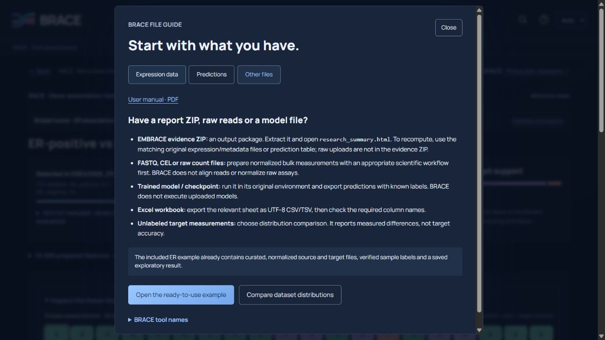

FDR is the expected false-discovery proportion controlled under the method assumptions; a q value is a multiplicity-adjusted measure, not the probability a specific claim is false. Hedges g is a small-sample-corrected standardized within-study mean difference. Preprocessing compatibility means measurements have an appropriate shared representation for the requested task. Prediction confidence is a model score unless calibration has been demonstrated. Selection, correlated features, donor dependence and post-hoc cohort choice limit generalization.

## 17. Official tool names

BRACE - Biological Reliability Assessment across Cohorts and Experiments

RACE - Replication Assessment of Cohort Effects

ACE - Algorithmic Classifier Evaluation

CE - Cohort Evaluation

EMBRACE - Evidence Management, Bundling, Reproducibility, Audit & Controlled Exports

SPACE - Study Provenance, Acquisition & Cohort Exploration

FACE - Feature Analysis of Cohort Expression

TRACE - Transparent Record of Analysis, Computation & Evidence

Plain-language actions remain primary. E and EMBRACE open one evidence workspace. SPACE belongs to acquisition; FACE and TRACE inspect the active result. Method identifiers and artifact schema versions retain their historical names independently of product release 1.2.4.

## Official file listing

Choose Acquire original & hash for the verified matrix listing. This acquires original bytes; Prepare this dataset for analysis is the next step.

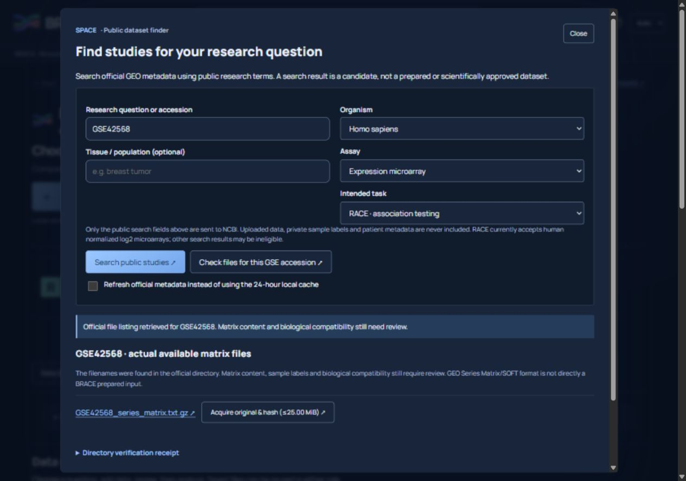

## Preparation fields

Review organism, identifiers, platform and measurement scale before selecting groups. Detected values are declarations that require scientific review.

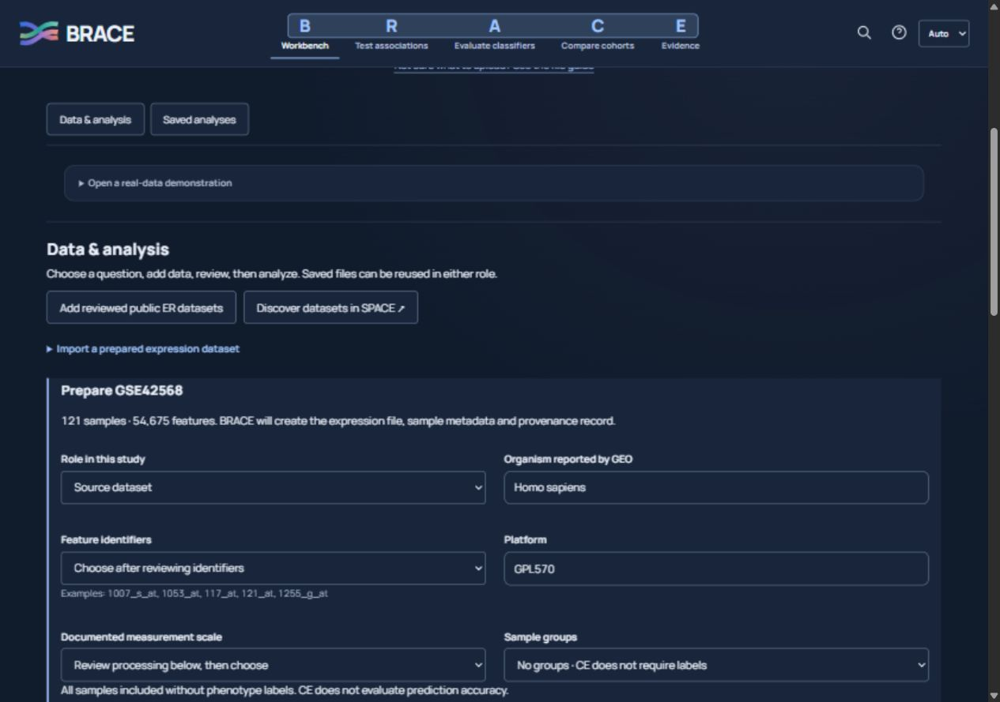

## Reference details

Expand Reference source & full summary in FACE. The dated source supports reference function only; it does not establish a mechanism for your result.

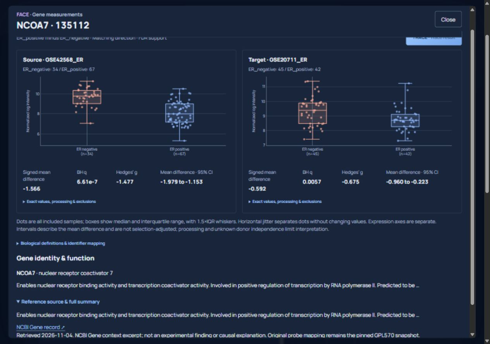

## Evidence files

Choose Files & limitations in EMBRACE. Keep original inputs identified by the hashes when reproducing the analysis.

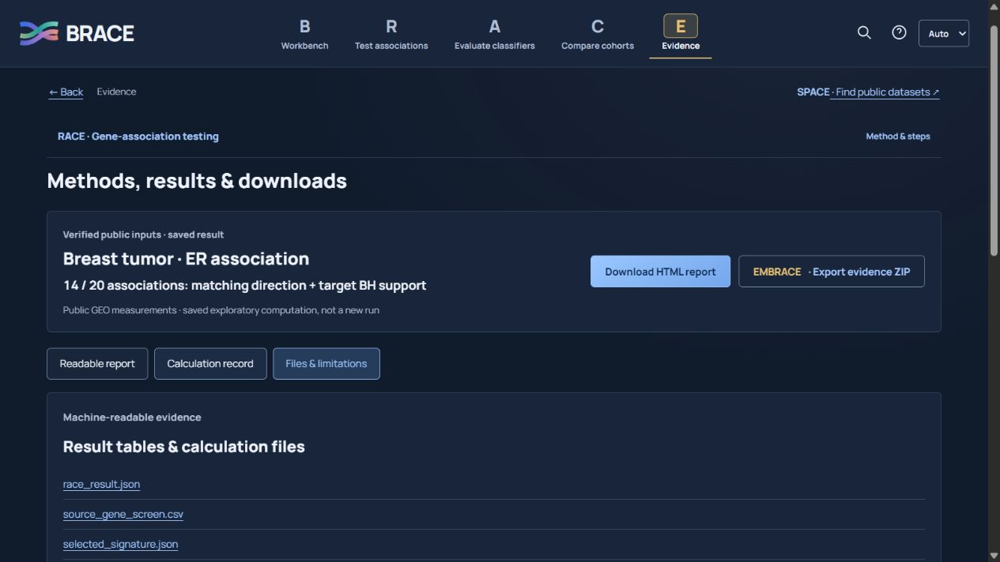

## Source-fitted projection

CE fits its transformation and PCA on source measurements and projects the target. Processing differences keep the example descriptive.

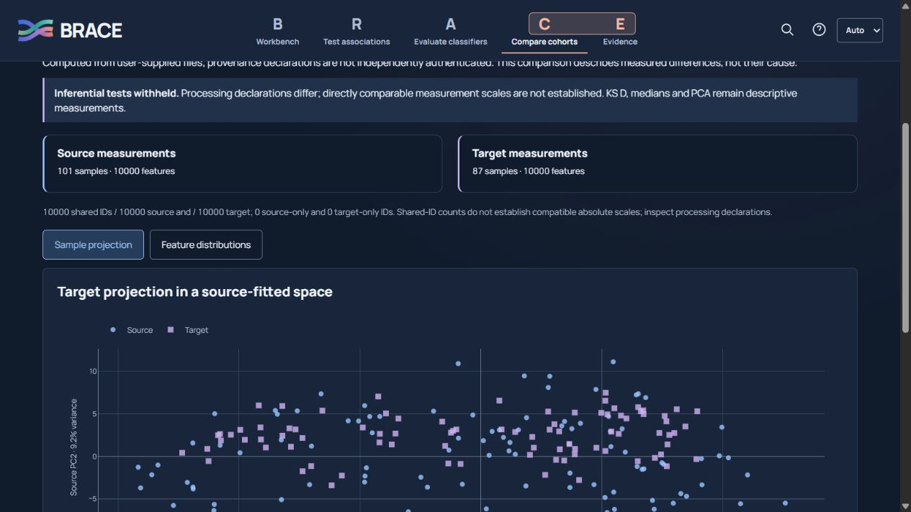

## Prediction mapping

Map columns and every declared class score, then review and save. The illustration uses actual archived CancerShift predictions; it is an import demonstration, not new model inference.

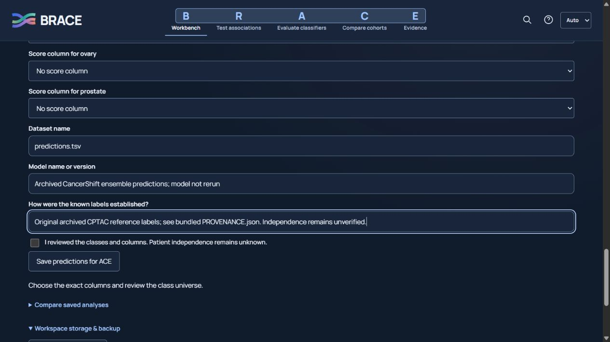

## Mixed data library

Saved data contains acquired originals, prepared expression versions and saved predictions. Prediction records have no expression-feature count. Inspect or prepare the selected record before choosing its study role.

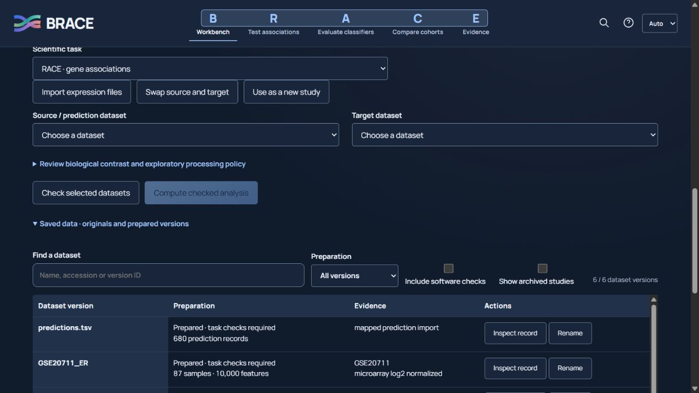

## References, rights and verification

[Scientific methods and limitations](https://github.com/hasan-bukhari-dev/BRACE/blob/v1.2.4/docs/SCIENTIFIC_PROTOCOL_1_0.md), [original data sources](https://github.com/hasan-bukhari-dev/BRACE/blob/v1.2.4/docs/DATA_SOURCES.md), [input contracts](https://github.com/hasan-bukhari-dev/BRACE/blob/v1.2.4/docs/DATA_GUIDE.md) and [reproduction instructions](https://github.com/hasan-bukhari-dev/BRACE/blob/v1.2.4/docs/REPRODUCIBILITY.md) provide the full technical record.

BRACE-authored material is rights reserved. Data and dependencies retain their own terms: read [the license](https://github.com/hasan-bukhari-dev/BRACE/blob/v1.2.4/LICENSE) and [third-party notices](https://github.com/hasan-bukhari-dev/BRACE/blob/v1.2.4/docs/THIRD_PARTY_NOTICES.md).

Screens show the actual local workbench, with guide annotations identified separately. Windows setup behavior is covered by installer lifecycle checks rather than fabricated installer screenshots. Automated and agent walkthroughs do not constitute independent unfamiliar-user acceptance, screen-reader testing or a WCAG compliance audit. The baseline example has only two target normal samples. Additional-cohort checks are exploratory post-hoc execution evidence, not clinical or prospective validation.

## Fresh computation and frozen replay

The interface walkthrough also computed a fresh GSE42568 to GSE20711 RACE run, preserving 14/20 support under the historical source configuration. Saved evidence and a fresh run have distinct IDs; opening the historical example does not rerun it.

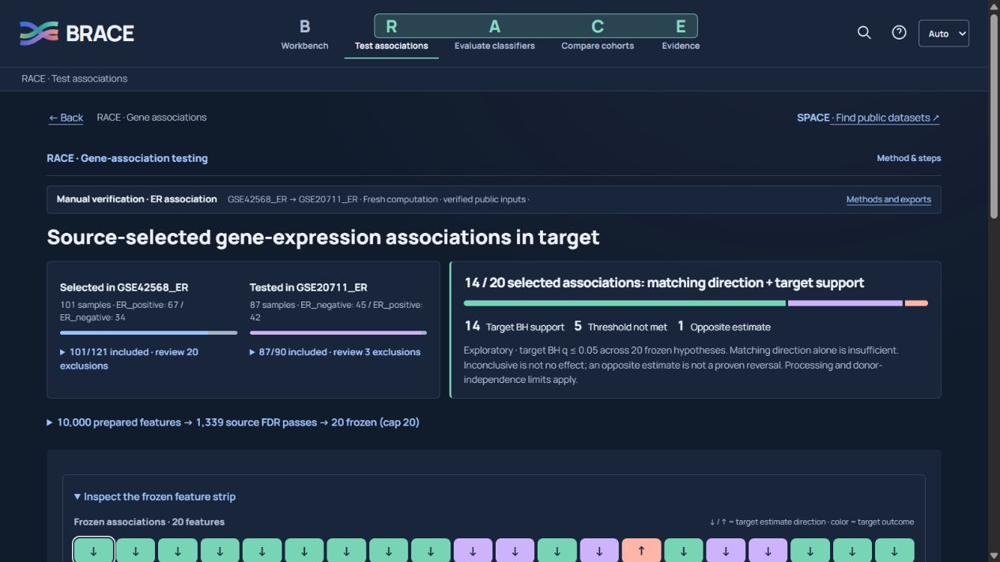

For replay, open Apply a previously frozen BRACE baseline, enter the replay study name, select the original source-trained run and a compatible target version, then Apply frozen baseline. The illustrated normal/tumor target is GSE20711 source_name. The completed replay retained 2/90 correct without target fitting; labels were used only for evaluation. An unlabeled target has predictions without accuracy.

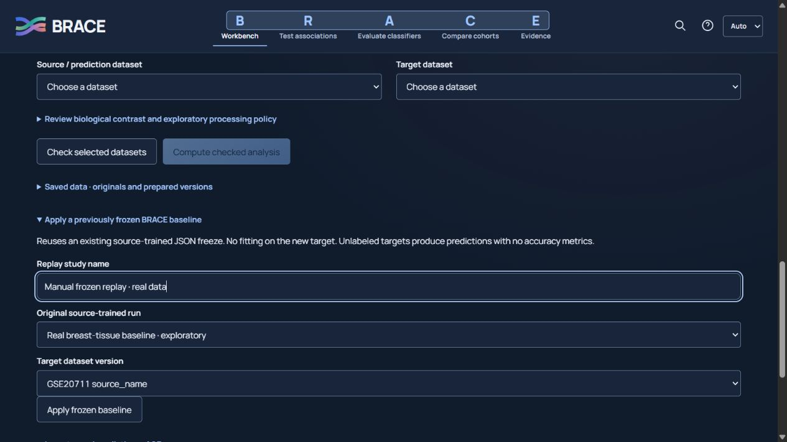
